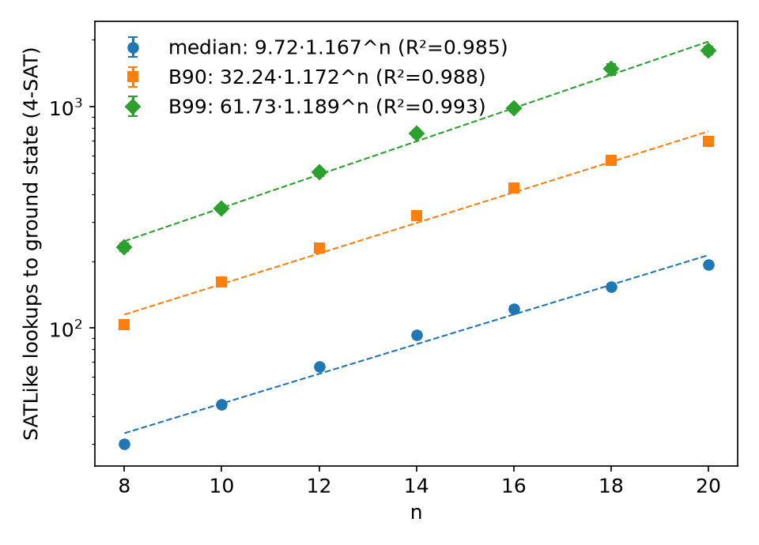

# SATLike convergence study: unweighted random 4-SAT (4sat_conv)

Instances: new unique-GS random 4-SAT, all clause weights 1 (otherwise same generator as wmaxsat_conv: 4 distinct vars/clause, m=round(9.93n)), seeds 1.1e10+1e7n+k (disjoint from every existing base). Both SAT (E_gs=0) and UNSAT kept. SATLike = strong_classical.runone, ONE cfg for all n: {'mode': 0, 'swt': 20, 'sp': 0.01, 't_bms': 3} (candidate A, best avg B90 over the same 4 candidates on held-out 200 inst x2 at n=12,16,20; logs/4sat/uniform_tune.out). Cap min(40*2^n,4e6), 5 runs/instance, strict lookups to first GS check. Unsolved = inf. Std = bootstrap over instances (1000 resamples).

| n | instances | runs | unsolved | median | B90 | B99 | unique-GS acceptance | SAT / UNSAT |
|---|---|---|---|---|---|---|---|---|
| 8 | 2000 | 10000 | 0 | 30 ± 0.7 | 103 ± 2.1 | 232 ± 9.4 | 2000/6710 = 0.2981 | 1979 / 21 |
| 10 | 2000 | 10000 | 0 | 45 ± 0.9 | 161 ± 3.0 | 347 ± 11.5 | 2000/7604 = 0.2630 | 1967 / 33 |
| 12 | 2000 | 10000 | 0 | 67 ± 1.2 | 229 ± 4.6 | 504 ± 18.0 | 2000/8293 = 0.2412 | 1956 / 44 |
| 14 | 2000 | 10000 | 0 | 93 ± 1.6 | 321 ± 6.7 | 752 ± 23.5 | 2000/9336 = 0.2142 | 1951 / 49 |
| 16 | 2000 | 10000 | 0 | 122 ± 2.4 | 428 ± 8.3 | 980 ± 32.0 | 2000/10120 = 0.1976 | 1939 / 61 |
| 18 | 2000 | 10000 | 0 | 154 ± 2.8 | 572 ± 9.3 | 1475 ± 83.1 | 2000/10979 = 0.1822 | 1941 / 59 |
| 20 | 2000 | 10000 | 0 | 193 ± 3.4 | 696 ± 15.1 | 1790 ± 72.7 | 2000/12256 = 0.1632 | 1938 / 62 |

## Fits a·b^n

| stat | a | b | R² |
|---|---|---|---|
| median | 9.723 | 1.1669 | 0.9849 |
| B90 | 32.241 | 1.1721 | 0.9881 |
| B99 | 61.734 | 1.1889 | 0.9934 |

## SAT vs UNSAT instances

| n | class | instances | unsolved | median | B90 | B99 |
|---|---|---|---|---|---|---|
| 8 | SAT | 1979 | 0 | 30 ± 0.7 | 103 ± 2.2 | 232 ± 9.1 |
| 8 | UNSAT | 21 | 0 | 34 ± 4.7 | 93 ± 12.0 | 151 ± 65.0 |
| 10 | SAT | 1967 | 0 | 45 ± 0.9 | 160 ± 2.9 | 342 ± 11.1 |
| 10 | UNSAT | 33 | 0 | 57 ± 5.6 | 203 ± 18.7 | 406 ± 72.7 |
| 12 | SAT | 1956 | 0 | 66 ± 1.1 | 228 ± 4.6 | 500 ± 18.2 |
| 12 | UNSAT | 44 | 0 | 72 ± 9.4 | 260 ± 28.8 | 529 ± 42.7 |
| 14 | SAT | 1951 | 0 | 92 ± 1.6 | 319 ± 6.9 | 731 ± 22.9 |
| 14 | UNSAT | 49 | 0 | 119 ± 9.5 | 410 ± 39.3 | 1222 ± 227.1 |
| 16 | SAT | 1939 | 0 | 120 ± 2.5 | 422 ± 7.6 | 979 ± 32.9 |
| 16 | UNSAT | 61 | 0 | 170 ± 13.4 | 570 ± 37.2 | 1013 ± 200.0 |
| 18 | SAT | 1941 | 0 | 152 ± 2.9 | 564 ± 9.8 | 1429 ± 80.4 |
| 18 | UNSAT | 59 | 0 | 223 ± 23.6 | 939 ± 79.1 | 2643 ± 2246.9 |
| 20 | SAT | 1938 | 0 | 191 ± 3.3 | 677 ± 14.6 | 1753 ± 64.3 |
| 20 | UNSAT | 62 | 0 | 293 ± 23.0 | 1074 ± 89.8 | 3679 ± 1221.2 |

## Convergence vs number of instances X (value ± std)

### median

| n | X=100 | X=250 | X=500 | X=1000 | X=2000 |
|---|---|---|---|---|---|
| 8 | 29 ± 2.3 | 30 ± 1.8 | 30 ± 1.4 | 30 ± 0.9 | 30 ± 0.7 |
| 10 | 41 ± 4.3 | 46 ± 2.4 | 45 ± 1.6 | 46 ± 1.2 | 45 ± 0.9 |
| 12 | 66 ± 3.4 | 61 ± 3.0 | 64 ± 2.3 | 65 ± 1.6 | 67 ± 1.2 |
| 14 | 90 ± 6.6 | 100 ± 5.5 | 98 ± 3.8 | 96 ± 2.5 | 93 ± 1.5 |
| 16 | 124 ± 9.8 | 135 ± 7.7 | 124 ± 4.5 | 122 ± 3.3 | 122 ± 2.5 |
| 18 | 173 ± 11.8 | 155 ± 7.1 | 157 ± 5.7 | 153 ± 4.2 | 154 ± 2.9 |
| 20 | 171 ± 12.4 | 178 ± 7.1 | 183 ± 6.1 | 186 ± 4.2 | 193 ± 3.2 |

### B90

| n | X=100 | X=250 | X=500 | X=1000 | X=2000 |
|---|---|---|---|---|---|
| 8 | 89 ± 7.0 | 107 ± 6.7 | 107 ± 4.6 | 102 ± 3.4 | 103 ± 2.1 |
| 10 | 136 ± 9.1 | 157 ± 7.2 | 161 ± 6.8 | 164 ± 4.5 | 161 ± 2.9 |
| 12 | 215 ± 12.4 | 227 ± 11.5 | 233 ± 9.1 | 230 ± 6.3 | 229 ± 4.8 |
| 14 | 302 ± 35.0 | 339 ± 25.3 | 331 ± 13.2 | 327 ± 8.8 | 321 ± 6.6 |
| 16 | 413 ± 36.1 | 446 ± 26.4 | 456 ± 18.3 | 440 ± 13.1 | 428 ± 8.2 |
| 18 | 630 ± 48.7 | 557 ± 24.1 | 588 ± 21.3 | 589 ± 13.9 | 572 ± 9.6 |
| 20 | 650 ± 51.1 | 671 ± 33.9 | 682 ± 24.0 | 670 ± 18.1 | 696 ± 14.8 |

### B99

| n | X=100 | X=250 | X=500 | X=1000 | X=2000 |
|---|---|---|---|---|---|
| 8 | 231 ± 30.8 | 264 ± 27.3 | 264 ± 19.6 | 232 ± 12.2 | 232 ± 9.2 |
| 10 | 275 ± 56.6 | 342 ± 48.3 | 336 ± 22.1 | 351 ± 15.5 | 347 ± 11.4 |
| 12 | 518 ± 61.5 | 465 ± 39.1 | 490 ± 30.1 | 504 ± 22.1 | 504 ± 18.0 |
| 14 | 718 ± 53.6 | 758 ± 37.3 | 792 ± 35.9 | 774 ± 27.4 | 752 ± 23.5 |
| 16 | 1046 ± 121.5 | 1063 ± 69.8 | 1022 ± 43.0 | 1034 ± 44.6 | 980 ± 31.2 |
| 18 | 1780 ± 298.9 | 1425 ± 183.7 | 1554 ± 144.3 | 1554 ± 126.1 | 1475 ± 86.6 |
| 20 | 1748 ± 193.7 | 1649 ± 159.9 | 1639 ± 110.2 | 1664 ± 103.8 | 1790 ± 70.5 |

## Weighted baseline (SATLIKE_CONV, commit 26769729) at n=20: median 221 ± 3.9, B90 871 ± 18.8, B99 2877 ± 161.8

