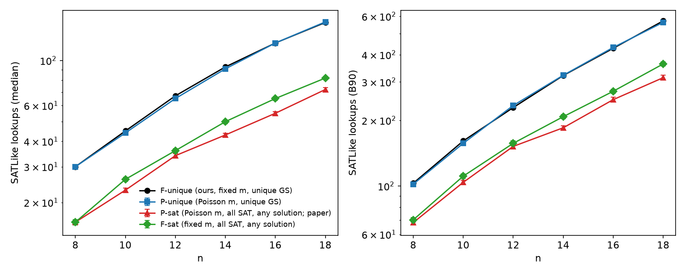

# SATLike on unweighted random 4-SAT: Poisson m vs fixed m, unique-GS vs all-SAT

Same generator as sat4_conv_run.py (4 distinct sorted vars, random signs, r=9.93), same SATLike cfg (logs/4sat/chosen_cfg.json: mode=0 swt=20 sp=0.01 t_bms=3), cap min(40·2^n,4e6), 5 runs/instance, 2000 instances per n per arm, strict lookups to first hit. Std = bootstrap over instances (1000 resamples). Script: noiseless/sat4_poisson_run.py, stats: noiseless/sat4_poisson_stats.py.

- **F-unique**: our existing study (SATLIKE_4SAT.md, commit e3740317): m=round(9.93n), unique ground state (SAT or UNSAT), hit = that string.
- **P-unique**: m ~ Poisson(9.93n), same unique-GS filter. Instance seeds 2.1e10+1e7n+k.
- **P-sat** (PRX Quantum 5, 030348 style): m ~ Poisson(9.93n), keep satisfiable instances only, hit = any satisfying string. Seeds 2.2e10+1e7n+k.
- **F-sat**: m=round(9.93n), keep satisfiable, hit = any satisfying string (separates the filter effect from the Poisson effect). Seeds 2.3e10+1e7n+k.

| n | arm | instances | unsolved | rejection | mean m | median #solutions | SAT frac | median | B90 | B99 |
|---|---|---|---|---|---|---|---|---|---|---|
| 8 | F-unique | 2000 | 0 | - | 79 | 1 | - | 30 | 103 | 232 |
| 8 | P-unique | 2000 | 0 | 0.718 | 81.5 | 1 | 0.935 | 30 ± 0.6 | 102 ± 2.5 | 225 ± 7.5 |
| 8 | P-sat | 2000 | 0 | 0.307 | 77.3 | 2 | 1.000 | 16 ± 0.4 | 68 ± 1.7 | 157 ± 4.8 |
| 8 | F-sat | 2000 | 0 | 0.274 | 79.0 | 2 | 1.000 | 16 ± 0.5 | 70 ± 1.6 | 169 ± 8.0 |
| 10 | F-unique | 2000 | 0 | - | 99 | 1 | - | 45 | 161 | 347 |
| 10 | P-unique | 2000 | 0 | 0.751 | 101.9 | 1 | 0.916 | 44 ± 0.8 | 157 ± 2.9 | 351 ± 12.6 |
| 10 | P-sat | 2000 | 0 | 0.301 | 96.7 | 2 | 1.000 | 23 ± 0.6 | 104 ± 2.3 | 260 ± 10.2 |
| 10 | F-sat | 2000 | 0 | 0.306 | 99.0 | 2 | 1.000 | 26 ± 0.6 | 111 ± 2.5 | 274 ± 9.4 |
| 12 | F-unique | 2000 | 0 | - | 119 | 1 | - | 67 | 229 | 504 |
| 12 | P-unique | 2000 | 0 | 0.783 | 122.0 | 1 | 0.912 | 65 ± 1.1 | 234 ± 4.9 | 526 ± 16.8 |
| 12 | P-sat | 2000 | 0 | 0.346 | 116.0 | 2 | 1.000 | 34 ± 0.8 | 152 ± 3.5 | 386 ± 18.4 |
| 12 | F-sat | 2000 | 0 | 0.319 | 119.0 | 2 | 1.000 | 36 ± 0.8 | 157 ± 4.2 | 395 ± 18.3 |
| 14 | F-unique | 2000 | 0 | - | 139 | 1 | - | 93 | 321 | 752 |
| 14 | P-unique | 2000 | 0 | 0.796 | 142.4 | 1 | 0.893 | 91 ± 1.6 | 322 ± 6.5 | 772 ± 32.6 |
| 14 | P-sat | 2000 | 0 | 0.352 | 135.3 | 3 | 1.000 | 43 ± 0.9 | 185 ± 3.7 | 525 ± 27.1 |
| 14 | F-sat | 2000 | 0 | 0.334 | 139.0 | 2 | 1.000 | 50 ± 1.0 | 208 ± 4.7 | 539 ± 17.7 |
| 16 | F-unique | 2000 | 0 | - | 159 | 1 | - | 122 | 428 | 980 |
| 16 | P-unique | 2000 | 0 | 0.809 | 162.4 | 1 | 0.883 | 122 ± 2.3 | 432 ± 6.8 | 1051 ± 52.9 |
| 16 | P-sat | 2000 | 0 | 0.374 | 155.5 | 3 | 1.000 | 55 ± 1.1 | 249 ± 6.6 | 699 ± 33.7 |
| 16 | F-sat | 2000 | 0 | 0.353 | 159.0 | 2 | 1.000 | 65 ± 1.3 | 272 ± 5.7 | 724 ± 21.2 |
| 18 | F-unique | 2000 | 0 | - | 179 | 1 | - | 154 | 572 | 1475 |
| 18 | P-unique | 2000 | 0 | 0.829 | 182.3 | 1 | 0.882 | 155 ± 2.4 | 563 ± 11.1 | 1518 ± 62.3 |
| 18 | P-sat | 2000 | 0 | 0.381 | 175.0 | 3 | 1.000 | 72 ± 1.5 | 314 ± 7.8 | 951 ± 45.9 |
| 18 | F-sat | 2000 | 0 | 0.377 | 179.0 | 3 | 1.000 | 82 ± 1.5 | 363 ± 8.6 | 1010 ± 43.3 |

## Fits a·b^n (n=8–18)

| arm | median | B90 | B99 |
|---|---|---|---|
| F-unique | 9.723·1.1669^n | 32.241·1.1721^n | 61.734·1.1889^n |
| P-unique | 8.421·1.1804^n | 28.294·1.1853^n | 52.318·1.2079^n |
| P-sat | 5.228·1.1597^n | 22.623·1.1613^n | 42.941·1.1918^n |
| F-sat | 4.931·1.1743^n | 21.372·1.1735^n | 45.902·1.1898^n |

## Ratio F-unique / arm (>1 means our set is harder)

| n | vs P-unique med / B90 | vs P-sat med / B90 | vs F-sat med / B90 |
|---|---|---|---|
| 8 | 1.00 / 1.01 | 1.88 / 1.51 | 1.88 / 1.47 |
| 10 | 1.02 / 1.03 | 1.96 / 1.55 | 1.73 / 1.45 |
| 12 | 1.03 / 0.98 | 1.97 / 1.51 | 1.86 / 1.46 |
| 14 | 1.02 / 1.00 | 2.16 / 1.74 | 1.86 / 1.54 |
| 16 | 1.00 / 0.99 | 2.22 / 1.72 | 1.88 / 1.57 |
| 18 | 0.99 / 1.02 | 2.14 / 1.82 | 1.88 / 1.58 |

## Verdict

- Poisson vs fixed m changes nothing measurable: P-unique matches F-unique within ~3% at every n (median and B90 within bootstrap error).
- The unique-GS filter is the whole effect: our F-unique set is ~1.9–2.2× harder at the median and ~1.5–1.8× at B90 than the paper-style P-sat set (n=8–18), and the gap grows slowly with n.
- Of that gap, ~1.9× (median) / ~1.5× (B90) comes from the filter + any-solution success (F-sat), and the extra ~10–15% at n≥14 from Poisson's lean toward low-m satisfiable instances (P-sat mean m ≈ 0.975·9.93n).
