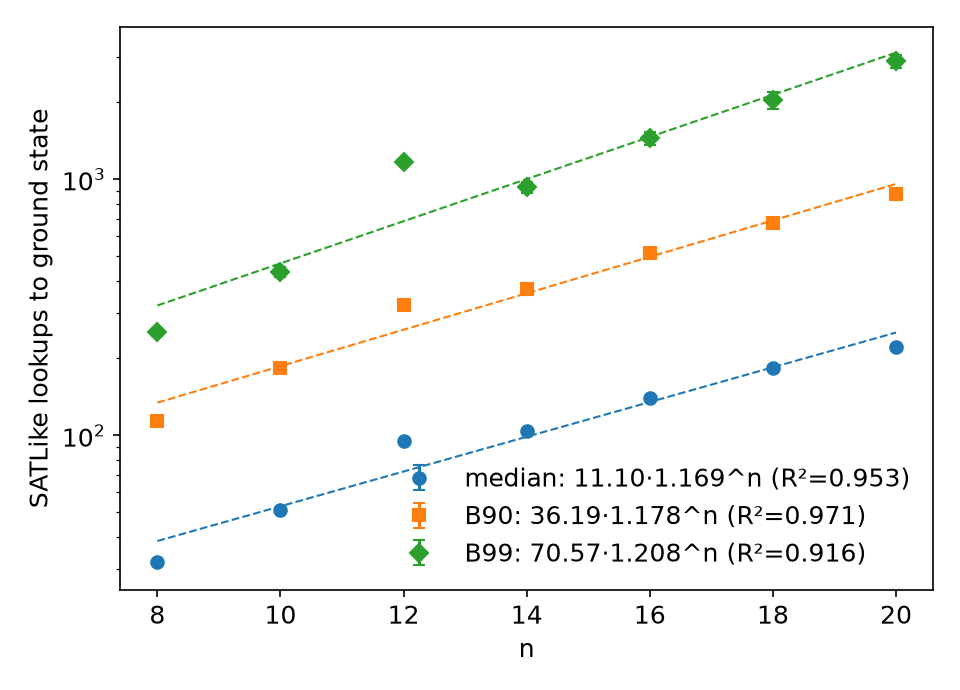

# SATLike convergence study (wmaxsat_conv)

Instances: new unique-GS random weighted 4-SAT (m=round(9.93n), w in 1..5), same generator as wmaxsat_fresh, seeds 5e9+1e7n+k (disjoint). SATLike = strong_classical.runone, cfg BEST[satlike|n], cap min(40*2^n,4e6), 5 runs/instance. Strict lookups to first GS check. Unsolved = inf. Std = bootstrap over instances (1000 resamples, instance keeps its runs).

| n | instances | runs | unsolved | median | B90 | B99 |
|---|---|---|---|---|---|---|
| 8 | 2000 | 10000 | 0 | 32 ± 0.7 | 114 ± 2.1 | 252 ± 8.6 |
| 10 | 2000 | 10000 | 0 | 51 ± 1.0 | 183 ± 3.6 | 433 ± 19.4 |
| 12 | 2000 | 10000 | 95 | 95 ± 2.1 | 323 ± 6.0 | 1170 ± inf |
| 14 | 2000 | 10000 | 1 | 104 ± 1.8 | 373 ± 7.3 | 929 ± 46.4 |
| 16 | 2000 | 10000 | 5 | 140 ± 2.5 | 514 ± 10.5 | 1439 ± 85.0 |
| 18 | 2000 | 10000 | 0 | 183 ± 3.5 | 673 ± 15.1 | 2031 ± 162.6 |
| 20 | 2000 | 10000 | 0 | 221 ± 3.9 | 871 ± 18.8 | 2877 ± 161.8 |

## Fits a·b^n

| stat | a | b | R² |
|---|---|---|---|
| median | 11.101 | 1.1689 | 0.9533 |
| B90 | 36.193 | 1.1779 | 0.9712 |
| B99 | 70.566 | 1.2085 | 0.9164 |

## Convergence vs number of instances X (value ± std)

### median

| n | X=100 | X=250 | X=500 | X=1000 | X=2000 |
|---|---|---|---|---|---|
| 8 | 26 ± 1.6 | 30 ± 1.6 | 30 ± 1.2 | 31 ± 0.9 | 32 ± 0.7 |
| 10 | 51 ± 4.1 | 50 ± 2.5 | 51 ± 2.0 | 51 ± 1.4 | 51 ± 1.0 |
| 12 | 89 ± 6.8 | 89 ± 5.4 | 97 ± 3.9 | 96 ± 2.9 | 95 ± 2.0 |
| 14 | 107 ± 8.2 | 109 ± 5.8 | 106 ± 4.3 | 102 ± 2.8 | 104 ± 1.8 |
| 16 | 129 ± 10.1 | 135 ± 7.5 | 136 ± 4.9 | 138 ± 3.8 | 140 ± 2.6 |
| 18 | 182 ± 15.7 | 174 ± 8.9 | 179 ± 6.8 | 183 ± 5.0 | 183 ± 3.6 |
| 20 | 223 ± 19.8 | 215 ± 11.5 | 216 ± 7.2 | 216 ± 5.5 | 221 ± 3.8 |

### B90

| n | X=100 | X=250 | X=500 | X=1000 | X=2000 |
|---|---|---|---|---|---|
| 8 | 108 ± 11.9 | 113 ± 5.1 | 111 ± 4.2 | 114 ± 2.8 | 114 ± 2.1 |
| 10 | 194 ± 20.4 | 177 ± 11.1 | 178 ± 6.9 | 182 ± 5.5 | 183 ± 3.6 |
| 12 | 300 ± 26.6 | 301 ± 18.1 | 313 ± 11.5 | 318 ± 7.5 | 323 ± 5.9 |
| 14 | 341 ± 27.4 | 379 ± 23.3 | 379 ± 17.2 | 373 ± 10.0 | 373 ± 7.3 |
| 16 | 449 ± 49.4 | 479 ± 31.6 | 501 ± 20.5 | 514 ± 15.2 | 514 ± 10.2 |
| 18 | 584 ± 51.5 | 608 ± 30.5 | 644 ± 26.4 | 666 ± 16.7 | 673 ± 14.8 |
| 20 | 804 ± 103.9 | 811 ± 59.6 | 822 ± 39.1 | 838 ± 25.1 | 871 ± 18.2 |

### B99

| n | X=100 | X=250 | X=500 | X=1000 | X=2000 |
|---|---|---|---|---|---|
| 8 | 275 ± 31.9 | 248 ± 21.7 | 234 ± 13.0 | 265 ± 14.5 | 252 ± 8.5 |
| 10 | 523 ± 120.2 | 394 ± 55.5 | 405 ± 20.0 | 417 ± 18.8 | 433 ± 18.9 |
| 12 | 806 ± inf | 806 ± inf | 788 ± inf | 763 ± inf | 1170 ± inf |
| 14 | 737 ± 92.8 | 1029 ± 131.1 | 1097 ± 115.1 | 948 ± 78.7 | 929 ± 46.9 |
| 16 | 1119 ± 592.8 | 1291 ± 322.1 | 1321 ± 141.8 | 1528 ± 128.5 | 1439 ± 80.0 |
| 18 | 1813 ± 518.2 | 1762 ± 219.6 | 1816 ± 439.0 | 1895 ± 140.3 | 2031 ± 151.9 |
| 20 | 2066 ± 389.5 | 2569 ± 570.8 | 2569 ± 265.8 | 2679 ± 187.1 | 2877 ± 160.1 |

