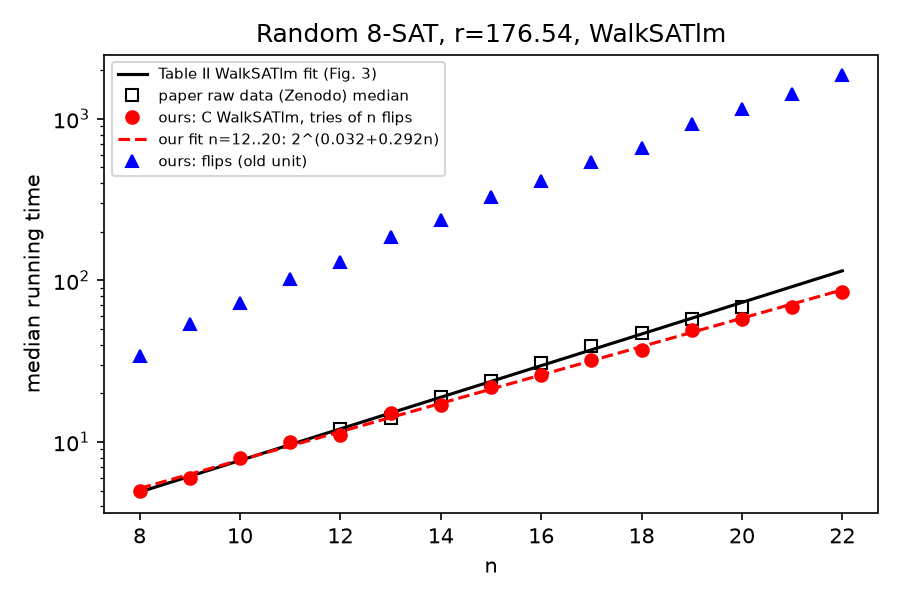

# Fig. 3 WalkSATlm reproduction (Boulebnane & Montanaro, PRX Quantum 5, 030348)

## What the paper says, and what it leaves out
- Ensemble: random k-SAT, Definition 1. m ~ Poisson(r n), k literals per clause drawn uniformly
  with replacement, k=8, r=176.54 (Table 1). Only satisfiable instances are kept.
- WalkSATlm with p=0.15, w1=6, w2=5, citing Cai et al. 2014. Classical running time is the
  "number of evaluations of the Boolean formula". The figure reports the median over instances,
  with a least-squares fit of log2(median) vs n.
- **The paper does not specify** what one evaluation is, the per-try cutoff, whether there are
  restarts, or which WalkSATlm source was used.

## What their data repository shows
GitHub `sami-b95/qaoa_ksat_paper_data` (`lib/analysis_helpers.py::load_walksatlm_benchmarks`) sets
`walksatlm_runtime = num_trials`. The Zenodo data (record 7764484) has one run per instance, with
fields `p=0.15, w1=6, w2=5, max_flips=n, max_tries=1e20`. There are 1415–6336 instances per n
(n=12..20). So **one "formula evaluation" = one try of n flips**. Recomputing medians and the fit
from their raw files gives **log2 = -0.3085 + 0.3246 n**, which exactly matches Table II
(-0.309 + 0.325 n). Their separate "probability" dataset (10000 tries of n flips, number of
successes counted) agrees: median 1/p_try ≈ 17.7 at n=12, which is about 12/ln 2.
- The WalkSATlm implementation itself is **not** in the repo. PySAT has no WalkSAT-family
  solver; its solvers are CDCL.
- Cai's official WalkSATlm2013 (lcs.ios.ac.cn/~caisw/Code/WalkSATlm2013.tar) hard-codes, for
  k≥7, wp≈0.115 with a=b=1 and **no restarts**. That is not the paper's p/w1/w2, so the paper
  used a parameterised implementation of its own or a modified one.

## Our rerun
`walksatlm_c/wslm.c` uses Cai's `pick_bbreak_gmake` rule with wp=p=0.15, a=w1=6, b=w2=5.
Each try starts from a fresh uniform random assignment and runs n flips; tries are counted until
SAT. It also counts flips. Instances are fresh from Definition 1 with seed 1000+n, brute-force
filtered to SAT (~58% satisfiable). We did one run per instance and took the median over
instances. The saved QAOA hamiltonians/ subsets were not rerun here.

```
{'fits': {'c1_tries': (np.float64(0.2917), np.float64(0.0323)), 'c1_flips': (np.float64(0.3868), np.float64(2.4702)), 'c1_flips+starts': (np.float64(0.381), np.float64(2.655)), 'c2_tries': (np.float64(0.2498), np.float64(-0.2109)), 'c2_flips': (np.float64(0.3512), np.float64(3.0932)), 'c2_flips+starts': (np.float64(0.3479), np.float64(3.1938)), 'c4_tries': (np.float64(0.2008), np.float64(-0.3054)), 'c4_flips': (np.float64(0.3134), np.float64(3.7454)), 'c4_flips+starts': (np.float64(0.3114), np.float64(3.8019)), 'paper_raw': (np.float64(0.3246), np.float64(-0.3085))}}
```
| n | instances | tries (cutoff n) | flips | flips+starts | paper raw median | Table II fit | tries c=2n | tries c=4n |
|---|---|---|---|---|---|---|---|---|
| 8 | 2000 | 5 | 34 | 39 | — | 4.9 | 3 | 2 |
| 9 | 2000 | 6 | 54 | 60 | — | 6.1 | 4 | 3 |
| 10 | 2000 | 8 | 72 | 80 | — | 7.7 | 5 | 3 |
| 11 | 2000 | 10 | 102 | 112 | — | 9.6 | 6 | 3 |
| 12 | 2000 | 11 | 130 | 141 | 12.0 | 12.1 | 7 | 4 |
| 13 | 2000 | 15 | 185 | 200 | 14.0 | 15.1 | 8 | 5 |
| 14 | 2000 | 17 | 236.5 | 253.5 | 19.0 | 18.9 | 10 | 6 |
| 15 | 2000 | 22 | 328 | 350 | 24.0 | 23.7 | 12 | 7 |
| 16 | 2000 | 26 | 413 | 439 | 31.0 | 29.7 | 13 | 7 |
| 17 | 2000 | 32 | 537 | 569 | 39.0 | 37.2 | 16 | 9 |
| 18 | 2000 | 37 | 655.5 | 692.5 | 47.0 | 46.6 | 20 | 10 |
| 19 | 2000 | 49 | 927.5 | 976.5 | 58.0 | 58.3 | 23 | 11 |
| 20 | 1459 | 58 | 1150 | 1208 | 68.0 | 73.1 | 28 | 13 |
| 21 | 751 | 68 | 1419 | 1487 | — | 91.5 | 33 | 16 |
| 22 | 340 | 85 | 1859.5 | 1944.5 | — | 114.6 | 37 | 16 |

Fits over n=12..20 (slope, intercept):

| counter | slope | intercept |
|---|---|---|
| paper Table II | 0.325 | -0.309 |
| paper raw data (recomputed) | 0.3246 | -0.3085 |
| **ours, tries of n flips (paper unit)** | **0.292** | **0.032** |
| ours, flips | 0.387 | 2.47 |
| ours, tries of 2n / 4n flips | 0.250 / 0.201 | -0.21 / -0.31 |



## Verdict
- **Unit and gap: resolved.** Fig. 3 counts n-flip tries (restarts), not flips. One paper unit is
  about n flips. Our old Python numbers were flips from a single unrestarted walk, which is
  where the ~17–21× gap came from (the gap is ≈n). It was never a weaker solver.
- **Exact numbers: close, not exact.** With the paper's protocol our medians are within 10% of
  theirs for n=12..16. Ours fall below at larger n (58 vs 68 at n=20), so our slope is 0.292 vs
  0.325. Likely causes, none confirmed: details of their unreleased implementation (tie-breaking,
  whether each try restarts from random, how the noise step is applied) and sampling (ours has
  1459 instances at n=20). Using their raw data, Table II reproduces exactly.
- Note that the restart cutoff max_flips=n is far from optimal. With 4n cutoffs the *flip* scaling
  improves to 0.313 vs 0.387, so the paper's classical exponent depends on this protocol choice.
